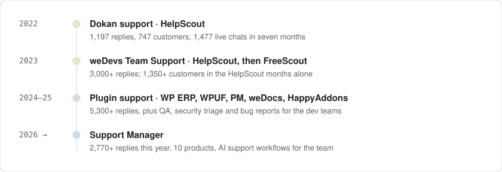

<picture>
  <source media="(prefers-color-scheme: dark)" srcset="assets/card-dark.svg">
  
</picture>

I lead customer support for the weDevs WordPress and SaaS products. My job is to make support faster and more accurate, so customers get exact answers, developers get bug reports they can act on, and fewer customers churn.

### Journey

<picture>
  <source media="(prefers-color-scheme: dark)" srcset="assets/journey-dark.svg">
  
</picture>

### Value I bring

| | |
|---|---|
| **AI support system** | A Claude Code pipeline that reads a ticket, checks the code, reproduces the bug on a test site, and drafts the GitHub issue and the customer reply. An independent review checks each draft, and every step is human-approved. |
| **Release → customer loop** | Every release is checked against open issues and the vulnerability log, so customers waiting on a fix hear about it the day it ships. |
| **Revenue recovery** | Failed-payment outreach from Stripe, and a 7-play customer-success program that uses PostHog data to rescue trials, checkouts and churned customers. |
| **Security triage** | Wordfence, Patchstack and WPScan reports taken through to verified fixes. |
| **Team tooling** | A shared issue tracker for all products, MCP servers for FreeScout and [Crisp](https://github.com/Anower16/crisp-mcp), and auto-built monthly product reviews. |

### Products

    
 
  

Blue: WordPress plugins · Green: email · Sand: SaaS

### Works with

`support` HelpScout · FreeScout · Crisp · Slack  
`data` Stripe · PostHog · Google Sheets  
`build` Claude Code · MCP · Node.js · TypeScript · PHP · WordPress · MySQL

---

Numbers come from the weDevs monthly reports (2022–23), FreeScout productivity reports (Sep 2023 – Nov 2026), WordPress.org and GitHub. Happy to talk about support operations, QA, and AI in support: [LinkedIn](https://www.linkedin.com/in/mdanowerhossain/).
